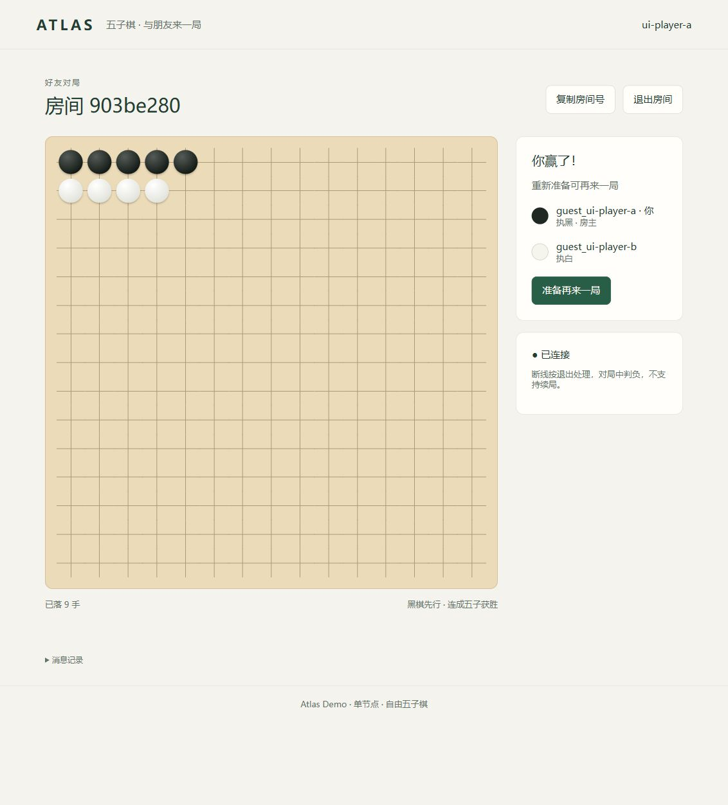

# Atlas Example

Atlas 是一个 Go 服务框架，提供 Actor 调度、服务发现、RPC 路由和连接管理。这个仓库用一局网页五子棋演示基于它怎么写业务，四个服务是 Auth、Logic、Room 和 Gate。

写业务只需要关心四件事：

- `cmd` 负责装配服务和注入依赖
- `api` 暴露 RPC，`internal` 实现业务
- Logic 用 model 组合玩家能力
- RPC 像普通函数一样调用，路由和连接由生成代码处理



## 1. `cmd` 负责装配服务和注入依赖

业务入口创建 App 和业务 Manager，把配置、服务发现、运行上下文和拦截器交给框架，再由 App 管理组件生命周期。Auth 依赖 Redis，于是它声明一个 injector，并注册 Redis 就绪检查：

```go
// cmd/auth/main.go
app := app.New(&cfg,
	app.WithInjector(&injector{redisConfig: &cfg.Redis}),
	app.WithReadinessCheck(time.Second, health.Check{
		Name:    "redis",
		Timeout: 500 * time.Millisecond,
		Check: func(ctx context.Context) error {
			return deps.Redis(ctx).Ping(ctx).Err()
		},
	}),
)
```

injector 校验配置、取出已初始化的连接放进 context，业务侧只用 `deps.Redis(ctx)` 取用：

```go
// cmd/auth/main.go
func (i *injector) Inject(ctx context.Context) context.Context {
	if i.redisConfig == nil || i.redisConfig.ProviderName == "" {
		panic("auth: Redis configuration is required")
	}
	rp, ok := loader.GetByConfig(i.redisConfig).(*redisprovider.Provider)
	if !ok || rp == nil || rp.Client() == nil {
		panic("auth: Redis provider must supply an initialized client")
	}
	return deps.WithRedis(ctx, rp.Client())
}
```

Server 的装配四个服务一致：把 App 提供的 Context、Discovery、Host、Readiness 和拦截器交给 `atlasgrpc.NewServer`，再 `app.Add(mgr, srv)`、`app.Run()`。入口只声明需要什么、如何装配，不承载业务。

## 2. `api` 暴露 RPC，`internal` 实现业务

`api/logic` 实现对外 RPC，把请求交给当前玩家执行业务：

```go
// api/logic/client.go
func (m *Manager) CreateRoom(ctx context.Context, _ *emptypb.Empty) (*roompb.RoomSnapshot, error) {
	return UserFromContext(ctx).RoomCreate(ctx)
}
```

玩家业务在 `internal/logic`，房间和棋盘规则在 `internal/room`。RPC 层只做接口适配和编排。

## 3. Logic 用 model 组合玩家能力

玩家由多个业务 model 组成，初始化时把玩家自身注入进去，每个 model 持有自己的状态和操作：

```go
// internal/logic/model.go
func (u *User) initModels(data ModelData) error {
	u.room.Init(u)
	if err := u.bag.Init(u, data.Bag); err != nil {
		return fmt.Errorf("init bag: %w", err)
	}
	u.models.list = []any{&u.bag, &u.room}
	return nil
}
```

Room model 只依赖它需要的能力，不依赖完整的 `User`：

```go
// internal/logic/room/manager.go
type deps interface {
	Key() string
	GetName() string
	GetSessionRef() gate.SessionRef
}
```

新增业务按同样方式加一个 model，不影响已有模块。

## 4. RPC 像调用普通函数，调用函数由协议生成

玩家创建或加入房间时，Room model 直接调用生成的服务函数：

```go
// internal/logic/room/manager.go
if create {
	snapshot, err = pb.CreateRoom(ctx, request)
} else {
	snapshot, err = pb.JoinRoom(ctx, request)
}
```

`pb.CreateRoom`、`pb.JoinRoom` 由业务 proto 生成。生成代码按请求里的 `room_id` 算出分片路由键，按服务名取到目标服务的连接再发起调用，并在等待下游返回时通过 `xsync.Await` 让出当前 Actor 的执行队列。业务代码只传 `ctx` 和请求，不用自己算路由键、选 Room 实例，也不用维护 gRPC 连接。

## 目录约定

- `cmd/<服务>`：入口、配置和依赖装配。
- `api/<服务>`：对外 RPC 接口及服务间编排。
- `internal/<服务>`：业务实现和领域状态。
- `proto`、`gen/proto/go`：业务协议与生成代码。
- `util/deps`：业务共享的 context 依赖访问器。

## 运行示例

```powershell
docker compose up -d
pnpm --dir web dev
```

浏览器打开 `http://127.0.0.1:5173`，用两个不同账号登录即可对局。框架依赖为私有仓库，运行前需要具备 `github.com/canda6/atlas` 的访问权限。
